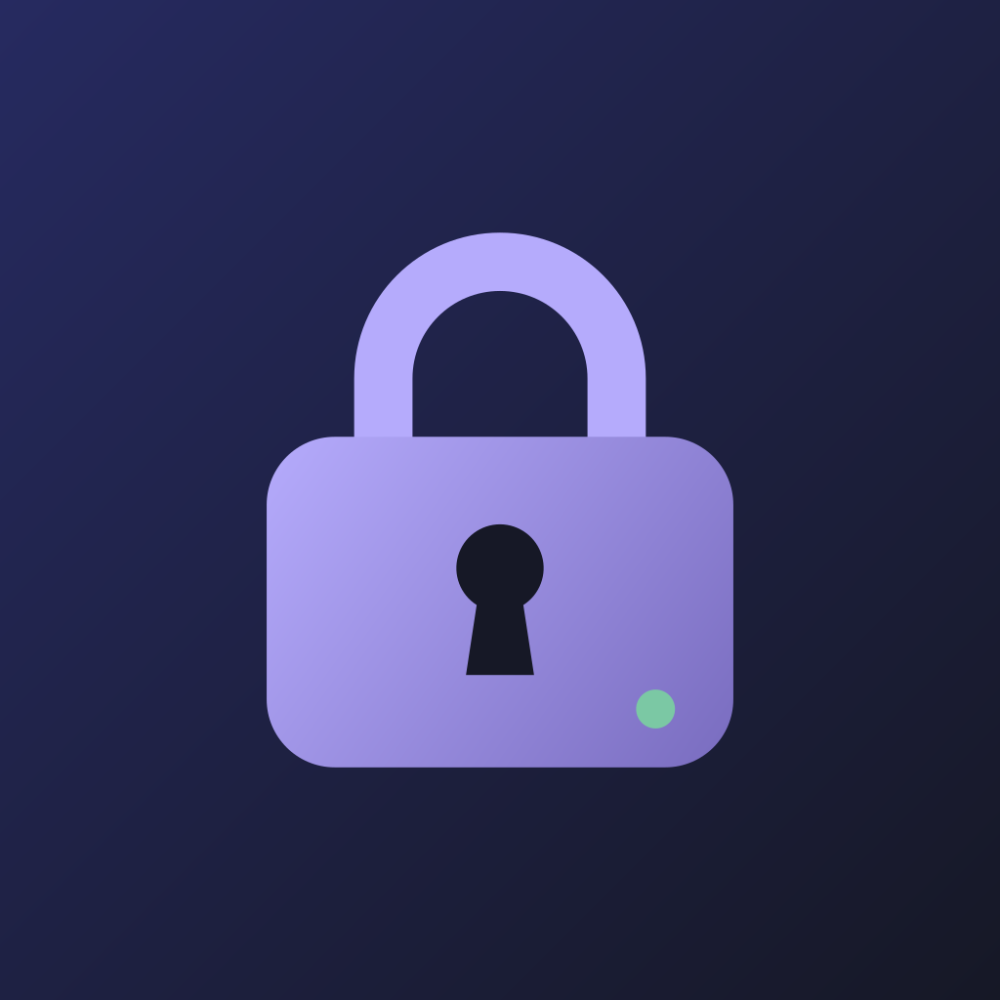
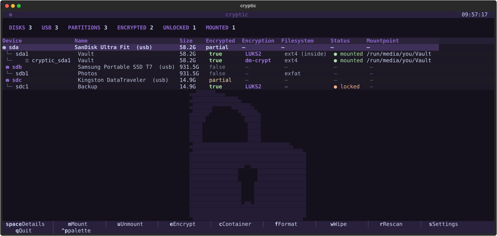
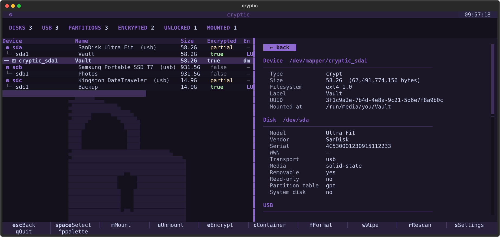
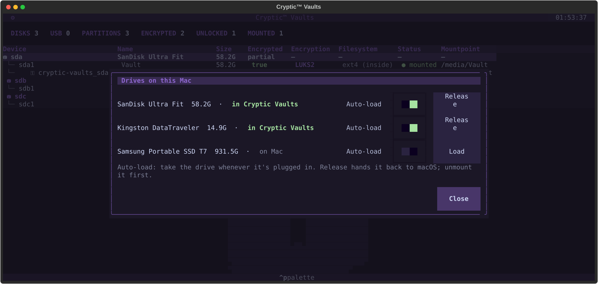

<div align="center">



# Cryptic™ Vaults for Linux and macOS

*LUKS2 encrypted drives from your terminal*


[](LICENSE)

[Features](#features) • [Install](#install) • [Usage](#usage) • [macOS](#on-macos) • [Troubleshooting](#troubleshooting)

</div>

<p align="center"></p>

Cryptic Vaults is a keyboard-driven manager for encrypted drives. Plug in a USB stick, unlock it, use your files, lock it again, without remembering a single `cryptsetup` flag. It can also encrypt a new drive, make encrypted container files, and wipe what you no longer need.

Everything it creates is standard **LUKS2**, the format `cryptsetup` uses on Linux. A drive made here opens on any Linux machine, with or without Cryptic Vaults, and in [Cryptic Vaults for Android](https://github.com/nockesocks/cryptic-vaults-android), so one stick moves between your desktop and your phone.

## Built for privacy

- No telemetry, analytics, ads or account.
- Nothing is sent anywhere. On macOS the only network traffic is between your Mac and its own local VM.
- Passphrases are passed straight to `cryptsetup` and never written to disk.
- Your system drive is protected, and anything that erases a drive makes you type its name first.

## Features

- **Unlock and mount** – LUKS2 and LUKS1 drives and partitions, with a second chance when you mistype the passphrase.
- **Encrypt a drive** – Fresh GPT, one partition, LUKS2 with AES-XTS-512, Argon2id and SHA-512, then ext4, exFAT, btrfs, XFS, FAT or NTFS, whichever tools are installed.
- **Encrypted containers** – Keep an encrypted "vault" file on a normal drive without touching the rest of it.
- **Format and wipe** – Quick signature wipe, zeros, random data, or TRIM for SSDs.
- **Edit** – Rename a drive or change its passphrase from its details.
- **Details** – Disk, USB, partition and LUKS header information, plus SMART health on Linux.
- **macOS support** – The same app on a Mac, with your unlocked drives showing up in Finder. See [On macOS](#on-macos).
- **Themes** – Three purple Catppuccin-style themes, with an optional transparent background.

## Install

### Linux

```sh
git clone https://github.com/nockesocks/cryptic-vaults.git && cd cryptic-vaults && ./install.sh
```

Or in one line:

```sh
curl -fsSL https://raw.githubusercontent.com/nockesocks/cryptic-vaults/main/install.sh | sh
```

The installer adds what Cryptic Vaults needs (Python, [Textual](https://textual.textualize.io), cryptsetup and the filesystem tools) with `pacman`, `apt`, `dnf` or `zypper`, then installs the `cryptic-vaults` command.

### macOS

Cryptic Vaults runs in a small Linux VM on your Mac (tested on Apple silicon), so first install the tools it uses:

```sh
brew install colima docker docker-compose qemu
```

Then run the same installer. It asks where unlocked drives should appear (default `~/cryptic-vaults`) and builds Cryptic Vaults' image.

```sh
git clone https://github.com/nockesocks/cryptic-vaults.git && cd cryptic-vaults && ./install.sh
```

> [!IMPORTANT]
> Cryptic Vaults reads your drives directly, which macOS only allows with **Full Disk Access** (System Settings ▸ Privacy & Security ▸ Full Disk Access). Grant it to your terminal app **and** to any multiplexer you run inside it (tmux, zellij…), then restart them. Without it, drives never show up.

To remove Cryptic Vaults, run `./install.sh --uninstall`. Your settings are kept.

## Usage

```sh
cryptic-vaults
```

Type your sudo password when asked: Cryptic Vaults needs root to unlock and mount drives.

### Keys

| Key | What it does |
|---|---|
| `↑` `↓` | Pick a drive |
| `space` | Details |
| `m` | Mount (asks for the passphrase if the drive is encrypted) |
| `u` | Unmount, and lock it if it's encrypted |
| `e` | Encrypt (erases the drive) |
| `f` | Format (erases the drive) |
| `w` | Wipe (erases the drive) |
| `c` | Make an encrypted container file |
| `a` | Open an existing container file |
| `d` | Drives on this Mac (macOS only) |
| `r` | Rescan |
| `s` | Settings |
| `l` | Command log: every command Cryptic Vaults has run |
| `ctrl+p` | Menu: themes, settings, log |
| `q` | Quit |

### Details

<p align="center"></p>

Press `space` on a drive to see everything about it. **:: edit ::** at the bottom renames the drive or changes its passphrase.

### How to…

<details>
<summary><b>Encrypt a USB stick</b></summary>

1. Plug it in and run `cryptic-vaults`.
2. Pick the drive marked `(usb)` and press `e`.
3. Type a passphrase twice.
4. Type the drive's name (for example `/dev/sdb`) to confirm, then press **Encrypt**.

</details>

<details>
<summary><b>Open an encrypted drive</b></summary>

1. Pick it (it says `● locked`) and press `m`.
2. Type your passphrase and press **Mount**.

</details>

<details>
<summary><b>Encrypt only part of a drive</b></summary>

1. Pick the drive and press `m` to mount it.
2. Press `c`, choose a file name and size (for example `10G`), and type a passphrase twice.
3. You get an encrypted vault file on the drive. Nothing else is touched.

To open it later, press `a` and give the path to the vault file.

</details>

<details>
<summary><b>Unplug safely</b></summary>

Pick the drive and press `u`. When it says `● locked`, unplug it.

</details>

## On macOS

macOS can't read LUKS or ext4, so Cryptic Vaults brings its own Linux. When you start it, Cryptic Vaults boots a small VM, plugs your USB drives into it, and opens the same app you'd use on Linux. Each drive you unlock is shared back to your Mac and appears in your mount folder, so Finder and every other app can use it.

- **Drives load on their own.** Plug one in before or after starting Cryptic Vaults and it shows up within a few seconds.
- **Files appear in `~/cryptic-vaults/<name>`.** A mounted drive's details have **Open in Finder**, **Terminal here** and **Copy path** buttons.
- **`u` unmounts from the Mac first**, then locks the drive. If the Mac still has files open on it, Cryptic Vaults asks you to close them.
- **`q` closes everything**, hands the drives Cryptic Vaults was holding back to your Mac, and shuts the VM down.

### Choosing which drives Cryptic Vaults takes

<p align="center"></p>

Every drive is loaded into Cryptic Vaults by default, including ones you might only want to copy files from. Two ways to hand one back:

- In a drive's details, press **Release to Mac**, or switch **Auto-load** off so Cryptic Vaults leaves it alone next time.
- Press `d` for every drive plugged in right now, with its Auto-load switch and a **Load** or **Release** button.

Cryptic Vaults remembers your choice for each drive, so a drive you released once stays with your Mac until you switch it back on.

> [!NOTE]
> On a Mac, SMART health isn't available: inside the VM a USB drive is a plain virtual disk.

## Troubleshooting

<details>
<summary><b>Unmounting says "target is busy"</b></summary>

Something still has files open on the drive. Close any terminal, file manager or app using it and press `u` again.

</details>

<details>
<summary><b>macOS: no drives show up, or the log says "Operation not permitted"</b></summary>

Your terminal, or a multiplexer inside it, lacks Full Disk Access. See the [macOS install](#macos) note, then restart the app you granted it to. Errors from the Mac side are written to `~/.config/cryptic-vaults/tui/cryptic-vaults-mac.log`.

</details>

<details>
<summary><b>macOS: Cryptic Vaults took a drive I wanted to use on the Mac</b></summary>

Open its details and press **Release to Mac**, and switch **Auto-load** off so it isn't taken next time. Press `d` to bring it back later.

</details>

## Where things are

| | Linux | macOS |
|---|---|---|
| `cryptic-vaults` command | `/usr/local/bin/cryptic-vaults` | `~/.local/bin/cryptic-vaults` |
| The app | `/usr/local/lib/cryptic-vaults/` | `~/.local/share/cryptic-vaults/` |
| Settings | `~/.config/cryptic-vaults/settings.json` | `~/.config/cryptic-vaults/tui/` |

> [!NOTE]
> Cryptic Vaults is free software under the [GNU General Public License v3.0](LICENSE): use it, study it, change it and share it. If you distribute a version of it, changed or not, its source goes with it under the same license.

## Trademark

Cryptic™ and the Cryptic padlock are trademarks of the developer. The license covers the code, not the name or the logo: a fork or a modified version you distribute needs its own name and icon.

## The Cryptic™ family

Cryptic Vaults is a member of the Cryptic™ family of utilities. Check out our other apps:

- [Cryptic Vaults for Android](https://github.com/nockesocks/cryptic-vaults-android): the same LUKS2 drives and containers on your phone.
- Cryptic Pass: a password manager. Coming soon.

See all Cryptic™ apps on [github.com/nockesocks](https://github.com/nockesocks).
